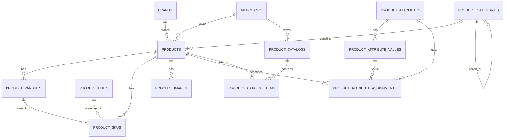

# Catalog Database — MKT-03 Product & Catalog

Dokumen ini menjelaskan desain schema `catalog` yang menjadi fondasi modul
**MKT-03 Product & Catalog**. Modul ini sengaja dipisahkan dari inventory dan
commerce: catalog menyimpan **identitas dan harga produk**, sedangkan stok dan
transaksi akan berada di schema lain.

- Schema PostgreSQL: `catalog`
- Jumlah tabel: **12**
- Migration: `drizzle/0001_*.sql`
- Kode schema: `src/db/schema/catalog.ts`
- Kode API: `src/routes/catalog/`

---

## 1. Keputusan Desain

1. **Master global vs milik merchant**
   - Kategori, brand, satuan, dan atribut adalah master global yang dikelola
     `platform_admin` atau `market_admin` (`catalog:manage`).
   - Produk, varian, SKU, gambar, dan katalog koleksi dimiliki merchant
     (`catalog:write` + akses merchant).
2. **Produk tidak menyimpan stok.**
   - Stok per lokasi, mutasi, dan opname akan berada di modul inventory
     (`MKT-08`). SKU hanya menyimpan identitas dan harga.
3. **SKU adalah unit yang diperdagangkan.**
   - Satu produk dapat memiliki banyak varian dan banyak SKU.
   - SKU dapat berdiri sendiri (tanpa varian) atau terhubung ke satu varian.
   - `sku_code` unik global; `barcode` unik dan boleh kosong.
4. **Soft delete produk.**
   - Produk yang dihapus di-archive (`status = archived`, `deleted_at` diisi)
     agar referensi historis tidak rusak.
   - Varian, SKU, dan gambar dihapus permanen hanya jika belum direferensikan
     transaksi. Untuk saat ini SKU boleh dihapus; aturan ini akan diperketat
     saat order/inventory sudah ada.
5. **Nilai uang disimpan sebagai `numeric(16,2)`.**
   - API mengembalikannya sebagai string desimal (mis. `"25000.00"`) untuk
     menghindari kehilangan presisi floating point.
6. **Slug unik per konteks.**
   - Kategori dan brand: slug unik global.
   - Produk dan katalog koleksi: slug unik per merchant.

---

## 2. ERD Ringkas



---

## 3. Tabel

### 3.1 Master Global

#### `product_categories`
Kategori produk berjenjang (self-reference `parent_id`).

| Kolom | Tipe | Catatan |
| --- | --- | --- |
| `id` | uuid PK | `gen_random_uuid()` |
| `parent_id` | uuid FK → self | `ON DELETE SET NULL` |
| `code` | varchar(64) unique | Auto `CAT-...` jika tidak diisi |
| `name`, `slug` | varchar | `slug` unik global |
| `description`, `image_url` | text | Opsional |
| `sort_order` | integer | Default 0 |
| `is_active` | boolean | Nonaktifkan tanpa hapus |
| `created_at`, `updated_at` | timestamptz | |

#### `brands`
| Kolom | Tipe | Catatan |
| --- | --- | --- |
| `id` | uuid PK | |
| `code` | varchar(64) unique | Auto `BRD-...` |
| `name`, `slug` | varchar | `slug` unik global |
| `description`, `logo_url`, `website` | text/varchar | Opsional |
| `is_active` | boolean | |
| `created_at`, `updated_at` | timestamptz | |

#### `product_units`
Satuan jual (pcs, kg, box, liter).

| Kolom | Tipe | Catatan |
| --- | --- | --- |
| `id` | uuid PK | |
| `code` | varchar(32) unique | Disimpan lowercase |
| `name` | varchar(128) | |
| `symbol` | varchar(16) | Opsional |
| `created_at` | timestamptz | |

#### `product_attributes`
Definisi atribut produk/varian (mis. warna, ukuran, rasa).

| Kolom | Tipe | Catatan |
| --- | --- | --- |
| `id` | uuid PK | |
| `code` | varchar(64) unique | Auto `ATTR-...` |
| `name` | varchar(128) | |
| `type` | enum `attribute_type` | `text`, `number`, `boolean`, `select` |
| `is_variant_attribute` | boolean | Dipakai untuk pembentukan varian |
| `is_required` | boolean | Validasi masa depan |
| `sort_order` | integer | |
| `created_at`, `updated_at` | timestamptz | |

#### `product_attribute_values`
Nilai yang diizinkan untuk atribut bertipe `select`.

| Kolom | Tipe | Catatan |
| --- | --- | --- |
| `id` | uuid PK | |
| `attribute_id` | uuid FK → `product_attributes` | `ON DELETE CASCADE` |
| `value` | varchar(128) | Unik per atribut |
| `label` | varchar(128) | Label tampilan |
| `sort_order` | integer | |
| `created_at` | timestamptz | |

---

### 3.2 Produk

#### `products`
| Kolom | Tipe | Catatan |
| --- | --- | --- |
| `id` | uuid PK | |
| `merchant_id` | uuid FK → `core.merchants` | `ON DELETE CASCADE` |
| `category_id` | uuid FK → `product_categories` | `ON DELETE SET NULL` |
| `brand_id` | uuid FK → `brands` | `ON DELETE SET NULL` |
| `name` | varchar(255) | |
| `slug` | varchar(255) | Unik per merchant |
| `short_description`, `description` | text | |
| `status` | enum `product_status` | `draft`, `active`, `inactive`, `archived` |
| `base_price` | numeric(16,2) | Harga dasar |
| `currency` | varchar(3) | Default `IDR` |
| `weight_gram` | integer | Berat dalam gram |
| `dimensions` | jsonb | `{ length, width, height }` |
| `is_featured` | boolean | |
| `created_by` | uuid FK → `core.users` | `ON DELETE SET NULL` |
| `created_at`, `updated_at`, `deleted_at` | timestamptz | Soft delete |

Index: `(merchant_id, slug)` unik, `merchant_id`, `category_id`, `brand_id`,
`status`.

#### `product_variants`
Kombinasi atribut yang dijual, mis. “Merah / L”.

| Kolom | Tipe | Catatan |
| --- | --- | --- |
| `id` | uuid PK | |
| `product_id` | uuid FK → `products` | `ON DELETE CASCADE` |
| `name` | varchar(255) | |
| `code` | varchar(64) | Unik per produk |
| `attributes` | jsonb | `{"warna":"merah","ukuran":"L"}` |
| `price` | numeric(16,2) | Override harga produk (opsional) |
| `is_default` | boolean | Satu varian default per produk |
| `status` | enum `variant_status` | `active`, `inactive` |
| `sort_order` | integer | |
| `created_at`, `updated_at` | timestamptz | |

#### `product_skus`
Identitas stok yang diperdagangkan.

| Kolom | Tipe | Catatan |
| --- | --- | --- |
| `id` | uuid PK | |
| `product_id` | uuid FK → `products` | `ON DELETE CASCADE` |
| `variant_id` | uuid FK → `product_variants` | `ON DELETE SET NULL` |
| `unit_id` | uuid FK → `product_units` | `ON DELETE SET NULL` |
| `sku_code` | varchar(100) unique | Auto `SKU-...` |
| `barcode` | varchar(100) unique | Boleh null |
| `price` | numeric(16,2) | Wajib |
| `cost_price` | numeric(16,2) | Opsional |
| `status` | enum `sku_status` | `active`, `inactive` |
| `created_at`, `updated_at` | timestamptz | |

#### `product_images`
| Kolom | Tipe | Catatan |
| --- | --- | --- |
| `id` | uuid PK | |
| `product_id` | uuid FK → `products` | `ON DELETE CASCADE` |
| `url` | text | URL gambar |
| `alt_text` | varchar(255) | |
| `is_primary` | boolean | Satu gambar utama per produk |
| `sort_order` | integer | |
| `created_at` | timestamptz | |

#### `product_attribute_assignments`
Nilai atribut pada level produk. Unik per `(product_id, attribute_id)`.

| Kolom | Tipe | Catatan |
| --- | --- | --- |
| `id` | uuid PK | |
| `product_id` | uuid FK → `products` | `ON DELETE CASCADE` |
| `attribute_id` | uuid FK → `product_attributes` | `ON DELETE CASCADE` |
| `value_id` | uuid FK → `product_attribute_values` | `ON DELETE SET NULL` |
| `custom_value` | varchar(255) | Untuk atribut teks bebas |
| `created_at` | timestamptz | |

Atribut kombinasi (warna/ukuran) disimpan di `product_variants.attributes`
sebagai JSONB; assignment di sini untuk spesifikasi produk secara umum.

---

### 3.3 Katalog Koleksi

#### `product_catalogs`
Katalog/daftar produk milik merchant, dapat dipublikasikan.

| Kolom | Tipe | Catatan |
| --- | --- | --- |
| `id` | uuid PK | |
| `merchant_id` | uuid FK → `core.merchants` | `ON DELETE CASCADE` |
| `name` | varchar(255) | |
| `slug` | varchar(255) | Unik per merchant |
| `description` | text | |
| `is_active` | boolean | |
| `is_public` | boolean | Default false |
| `created_at`, `updated_at` | timestamptz | |

#### `product_catalog_items`
| Kolom | Tipe | Catatan |
| --- | --- | --- |
| `id` | uuid PK | |
| `catalog_id` | uuid FK → `product_catalogs` | `ON DELETE CASCADE` |
| `product_id` | uuid FK → `products` | `ON DELETE CASCADE` |
| `price_override` | numeric(16,2) | Harga khusus katalog |
| `is_visible` | boolean | |
| `sort_order` | integer | |
| `created_at` | timestamptz | |

Unik per `(catalog_id, product_id)`.

---

## 4. Enum

| Enum | Nilai |
| --- | --- |
| `catalog.product_status` | `draft`, `active`, `inactive`, `archived` |
| `catalog.variant_status` | `active`, `inactive` |
| `catalog.sku_status` | `active`, `inactive` |
| `catalog.attribute_type` | `text`, `number`, `boolean`, `select` |

---

## 5. Otorisasi & Scoping

| Aksi | Permission | Batasan data |
| --- | --- | --- |
| Lihat kategori/brand/satuan/atribut | `catalog:read` | Semua user login |
| Kelola master katalog | `catalog:manage` | `platform_admin`, `market_admin` |
| Lihat produk/katalog | `catalog:read` | Hanya merchant yang boleh diakses |
| Buat/ubah/arsip produk | `catalog:write` | Owner/manager merchant atau anggota organisasi |
| Kelola katalog koleksi | `catalog:write` | Merchant yang sama |
| Lihat produk merchant lain | — | 404 (tidak membocorkan keberadaan data) |

Scoping produk memakai subquery merchant yang dapat diakses user:
owner merchant, anggota organisasi pemilik, atau anggota merchant aktif.
`platform_admin` melihat semua.

---

## 6. API

Base: `/api/v1/catalog`

- **Master**: `categories`, `brands`, `units`, `attributes`, `values`
- **Produk**: `products`, `variants`, `skus`, `images`, `attributes`
- **Koleksi**: `catalogs`, `catalogs/:id/items`

Daftar endpoint lengkap ada di [`../README.md`](../README.md#catalog--apiv1catalog).

Contoh membuat produk:

```bash
curl -X POST http://localhost:3000/api/v1/catalog/products \
  -H "Authorization: Bearer <TOKEN>" \
  -H "Content-Type: application/json" \
  -d '{
    "merchantId": "<MERCHANT_ID>",
    "categoryId": "<CATEGORY_ID>",
    "brandId": "<BRAND_ID>",
    "name": "Kue Cokelat",
    "basePrice": "25000",
    "status": "active"
  }'
```

---

## 7. Integritas & Batasan

- SKU tidak dapat dihapus jika sudah terhubung ke order/inventory pada modul
  berikutnya; untuk sekarang belum ada referensi tersebut.
- Varian yang masih memiliki SKU tidak dapat dihapus (HTTP 409).
- `barcode` unik, tetapi banyak nilai `NULL` diperbolehkan.
- Kategori dapat dinonaktifkan, bukan dihapus, agar produk lama tetap valid.
- Menghapus produk berarti archive; produk tidak muncul di list dan detail.
- Mengubah nama produk/kategori/brand tidak mengubah slug agar URL stabil.

---

## 8. Verifikasi

Typecheck dan uji end-to-end sudah dijalankan:

- `bun run typecheck` — lolos.
- `drizzle-kit generate` — 37 tabel terdeteksi, migration `0001` dibuat.
- E2E catalog — **31 pemeriksaan lolos, 0 gagal**, mencakup:
  master katalog, pembatasan permission, CRUD produk/varian/SKU/gambar,
  assignment atribut, scoping antar merchant (404), pencarian/filter,
  katalog koleksi, konflik hapus varian, dan archive produk.

Data uji E2E dibersihkan dari database lokal setelah pengujian.
