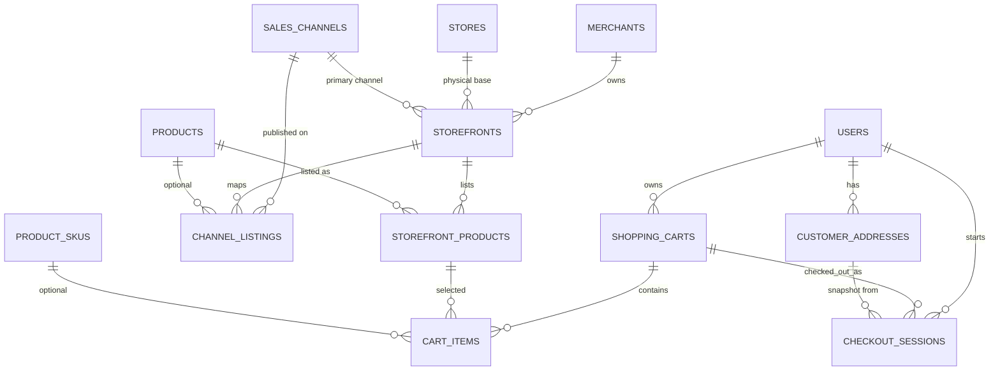

# Commerce Database — MKT-04 Marketplace & Omnichannel

Dokumen ini menjelaskan schema `commerce` yang menjadi fondasi modul
**MKT-04 Marketplace & Omnichannel Commerce**. Modul ini mengelola kanal
penjualan, storefront publik, katalog yang tampil di storefront, listing
marketplace eksternal, alamat pelanggan, keranjang, dan sesi checkout.

Order, item, status history, pembatalan, retur, dan ledger transaksi sudah
diimplementasikan pada MKT-05 dan dijelaskan di
[`order-database.md`](order-database.md). Pembayaran dan refund
diimplementasikan pada MKT-06 dan dijelaskan di
[`payment-database.md`](payment-database.md). Pengiriman dan fulfillment
belum masuk modul ini dan akan ditambahkan pada MKT-09.

- Schema PostgreSQL: `commerce`
- Jumlah tabel: **8**
- Migration: `drizzle/0002_*.sql`
- Kode schema: `src/db/schema/commerce.ts`
- Kode API: `src/routes/commerce/`

---

## 1. Keputusan Desain

1. **Storefront terpisah dari `core.stores`.**
   - `core.stores` adalah toko/kanal usaha merchant, termasuk toko fisik.
   - `commerce.storefronts` adalah etalase digital dengan slug publik.
   - Storefront dapat ditautkan ke satu `store` dan satu `sales_channel`.
2. **Kanal penjualan adalah master global.**
   - `sales_channels` dikelola dengan permission `commerce:manage`.
   - Seed awal: `web`, `marketplace`, `social`, `pos`.
3. **Katalog storefront memakai produk yang sudah ada.**
   - `storefront_products` hanya memilih produk dan mengatur harga tampilan.
   - Tidak ada duplikasi produk/SKU; produk tetap milik merchant di schema
     `catalog`.
4. **Harga efektif dihitung berlapis.**
   - `storefront_products.price_override` → `product_skus.price` →
     `products.base_price`.
   - Harga disimpan sebagai `numeric(16,2)` dan dikembalikan sebagai string.
5. **Keranjang hanya untuk user login.**
   - Satu user hanya memiliki satu cart `active` (partial unique index).
   - Cart dapat berisi item dari beberapa storefront/merchant. Pemecahan order
     per merchant dilakukan pada MKT-05.
6. **Checkout adalah snapshot.**
   - Saat checkout dibuat, item dan alamat disalin ke `items_snapshot` dan
     `address_snapshot`.
   - Perubahan cart setelah checkout tidak mengubah sesi checkout yang sudah
     dibuat.
7. **Harga dihitung ulang saat checkout.**
   - Jika harga produk berubah setelah masuk cart, harga cart diperbarui dan
     total checkout memakai harga terbaru.
   - Item yang storefront/produknya tidak lagi tersedia akan menolak checkout
     dengan HTTP 409.
8. **Soft delete storefront.**
   - Storefront diarsipkan dengan `deleted_at` dan status `inactive`, sehingga
     referensi cart/listing historis tetap aman.
9. **Publik hanya melihat data yang layak tayang.**
   - Storefront harus `published`, merchant `verified`, produk `active`, dan
     listing storefront `is_visible = true`.

---

## 2. ERD Ringkas



---

## 3. Tabel

### 3.1 Kanal & Storefront

#### `sales_channels`
Master kanal perdagangan.

| Kolom | Tipe | Catatan |
| --- | --- | --- |
| `id` | uuid PK | |
| `code` | varchar(64) unique | Disimpan lowercase, mis. `web` |
| `name` | varchar(128) | |
| `type` | enum `sales_channel_type` | `web`, `marketplace`, `social`, `pos`, `other` |
| `status` | enum `sales_channel_status` | `active`, `inactive` |
| `description`, `logo_url` | text | Opsional |
| `config` | jsonb | Konfigurasi kanal |
| `sort_order` | integer | |
| `created_at`, `updated_at` | timestamptz | |

#### `storefronts`
Etalase digital milik merchant.

| Kolom | Tipe | Catatan |
| --- | --- | --- |
| `id` | uuid PK | |
| `merchant_id` | uuid FK → `core.merchants` | `ON DELETE CASCADE` |
| `store_id` | uuid FK → `core.stores` | Opsional, `SET NULL` |
| `sales_channel_id` | uuid FK → `sales_channels` | Opsional, `SET NULL` |
| `name` | varchar(255) | |
| `slug` | varchar(255) unique | URL publik storefront |
| `description` | text | |
| `logo_url`, `banner_url` | text | |
| `status` | enum `storefront_status` | `draft`, `published`, `inactive`, `suspended` |
| `currency` | varchar(3) | Default `IDR` |
| `contact_name`, `contact_phone`, `contact_email` | varchar | |
| `settings` | jsonb | Pengaturan tampilan/operasional |
| `is_featured` | boolean | Storefront unggulan |
| `published_at` | timestamptz | Diisi saat pertama kali publish |
| `created_at`, `updated_at`, `deleted_at` | timestamptz | Soft delete |

#### `storefront_products`
Produk yang ditampilkan pada storefront.

| Kolom | Tipe | Catatan |
| --- | --- | --- |
| `id` | uuid PK | |
| `storefront_id` | uuid FK → `storefronts` | `ON DELETE CASCADE` |
| `product_id` | uuid FK → `catalog.products` | `ON DELETE CASCADE` |
| `price_override` | numeric(16,2) | Harga khusus storefront |
| `compare_at_price` | numeric(16,2) | Harga sebelum diskon |
| `is_visible` | boolean | |
| `is_featured` | boolean | |
| `sort_order` | integer | |
| `created_at`, `updated_at` | timestamptz | |

Unik per `(storefront_id, product_id)`.

#### `channel_listings`
Pemetaan produk ke kanal eksternal (marketplace/social commerce).

| Kolom | Tipe | Catatan |
| --- | --- | --- |
| `id` | uuid PK | |
| `channel_id` | uuid FK → `sales_channels` | `ON DELETE CASCADE` |
| `storefront_id` | uuid FK → `storefronts` | `ON DELETE CASCADE` |
| `product_id` | uuid FK → `catalog.products` | Opsional, `SET NULL` |
| `external_listing_id` | varchar(255) | Unik per kanal |
| `title`, `description` | varchar/text | |
| `price` | numeric(16,2) | Harga di kanal eksternal |
| `currency` | varchar(3) | |
| `status` | enum `listing_status` | `draft`, `active`, `paused`, `ended` |
| `external_url` | text | |
| `metadata` | jsonb | Payload sinkronisasi |
| `last_synced_at` | timestamptz | |
| `created_at`, `updated_at` | timestamptz | |

### 3.2 Pelanggan, Cart, Checkout

#### `customer_addresses`
Alamat pengiriman milik user.

| Kolom | Tipe | Catatan |
| --- | --- | --- |
| `id` | uuid PK | |
| `user_id` | uuid FK → `core.users` | `ON DELETE CASCADE` |
| `label` | varchar(64) | Default `Rumah` |
| `type` | enum `address_type` | `home`, `office`, `other` |
| `recipient_name`, `phone` | varchar | Wajib |
| `address_line1`, `address_line2` | text | |
| `city`, `province`, `postal_code`, `country` | varchar | `country` default `ID` |
| `latitude`, `longitude` | numeric(10,7) | |
| `is_default` | boolean | Maksimal satu default per user |
| `created_at`, `updated_at`, `deleted_at` | timestamptz | Soft delete |

Partial unique index: `(user_id) WHERE is_default = true AND deleted_at IS NULL`.

#### `shopping_carts`
Keranjang aktif user.

| Kolom | Tipe | Catatan |
| --- | --- | --- |
| `id` | uuid PK | |
| `user_id` | uuid FK → `core.users` | |
| `status` | enum `cart_status` | `active`, `converted`, `abandoned`, `expired` |
| `currency` | varchar(3) | Default `IDR` |
| `expires_at` | timestamptz | Default 30 hari dari pembuatan |
| `created_at`, `updated_at` | timestamptz | |

Partial unique index: satu cart `active` per user.

#### `cart_items`
| Kolom | Tipe | Catatan |
| --- | --- | --- |
| `id` | uuid PK | |
| `cart_id` | uuid FK → `shopping_carts` | `ON DELETE CASCADE` |
| `storefront_product_id` | uuid FK → `storefront_products` | `ON DELETE CASCADE` |
| `sku_id` | uuid FK → `catalog.product_skus` | Opsional, `SET NULL` |
| `quantity` | integer | 1–999 |
| `unit_price` | numeric(16,2) | Snapshot saat ditambahkan |
| `product_name`, `sku_code` | varchar | Snapshot tampilan |
| `notes` | text | |
| `created_at`, `updated_at` | timestamptz | |

#### `checkout_sessions`
| Kolom | Tipe | Catatan |
| --- | --- | --- |
| `id` | uuid PK | |
| `cart_id` | uuid FK → `shopping_carts` | |
| `user_id` | uuid FK → `core.users` | |
| `status` | enum `checkout_status` | `draft`, `pending`, `ready`, `expired`, `cancelled`, `completed` |
| `currency` | varchar(3) | |
| `item_count` | integer | Total quantity |
| `subtotal`, `discount_total`, `shipping_total`, `grand_total` | numeric(16,2) | |
| `address_id` | uuid FK → `customer_addresses` | Opsional, `SET NULL` |
| `address_snapshot` | jsonb | Snapshot alamat |
| `items_snapshot` | jsonb | Snapshot item + harga |
| `contact_name`, `contact_phone`, `contact_email` | varchar | |
| `notes` | text | |
| `expires_at` | timestamptz | Default 30 menit |
| `completed_at` | timestamptz | Diisi MKT-05 saat order dibuat |
| `created_at`, `updated_at` | timestamptz | |

Partial unique index: satu sesi aktif (`draft`/`pending`/`ready`) per cart.

---

## 4. Enum

| Enum | Nilai |
| --- | --- |
| `commerce.sales_channel_type` | `web`, `marketplace`, `social`, `pos`, `other` |
| `commerce.sales_channel_status` | `active`, `inactive` |
| `commerce.storefront_status` | `draft`, `published`, `inactive`, `suspended` |
| `commerce.listing_status` | `draft`, `active`, `paused`, `ended` |
| `commerce.cart_status` | `active`, `converted`, `abandoned`, `expired` |
| `commerce.checkout_status` | `draft`, `pending`, `ready`, `expired`, `cancelled`, `completed` |
| `commerce.address_type` | `home`, `office`, `other` |

---

## 5. Otorisasi & Scoping

| Aksi | Permission | Batasan data |
| --- | --- | --- |
| Lihat kanal penjualan | `commerce:read` | Semua user login |
| Kelola kanal penjualan | `commerce:manage` | `platform_admin`, `market_admin` |
| Lihat storefront | `commerce:read` | Merchant yang boleh diakses user |
| Buat/ubah/arsip storefront | `commerce:write` | Owner/manager merchant/anggota organisasi |
| Kelola produk storefront | `commerce:write` | Merchant pemilik storefront |
| Kelola listing kanal | `commerce:write` | Merchant pemilik storefront |
| Lihat katalog publik | publik | Hanya storefront `published` + merchant `verified` |
| Kelola alamat sendiri | `commerce:write` | Hanya alamat milik user |
| Cart/checkout | `commerce:read` / `commerce:write` | Hanya cart/checkout milik user |

`platform_admin` (`*`) melihat semua storefront. User lain hanya melihat
storefront milik merchant yang dapat diakses. Storefront merchant lain
dikembalikan sebagai **404** agar keberadaannya tidak bocor.

---

## 6. API

Base privat: `/api/v1/commerce`
Base publik: `/api/v1/commerce/marketplace`

### Kanal & storefront

- `GET/POST /channels`, `GET/PATCH/DELETE /channels/:id`
- `GET/POST /storefronts`, `GET/PATCH/DELETE /storefronts/:id`
- `GET/POST /storefronts/:id/products`
- `PATCH/DELETE /storefronts/:id/products/:itemId`
- `GET/POST /listings`, `PATCH/DELETE /listings/:id`

### Cart, alamat, checkout

- `GET/DELETE /cart`
- `POST /cart/items`, `PATCH/DELETE /cart/items/:itemId`
- `GET/POST /addresses`, `PATCH/DELETE /addresses/:id`
- `POST /checkout`, `GET/PATCH /checkout/:id`, `POST /checkout/:id/cancel`

### Publik

- `GET /marketplace/storefronts` — pencarian storefront
- `GET /marketplace/storefronts/:slug` — detail storefront
- `GET /marketplace/storefronts/:slug/products` — katalog storefront
- `GET /marketplace/storefronts/:slug/products/:productSlug` — detail produk
- `GET /marketplace/products` — pencarian produk lintas storefront

Contoh menambahkan produk ke storefront:

```bash
curl -X POST http://localhost:3000/api/v1/commerce/storefronts/<ID>/products \
  -H "Authorization: Bearer <TOKEN>" \
  -H "Content-Type: application/json" \
  -d '{
    "productId": "<PRODUCT_ID>",
    "priceOverride": "20000",
    "isVisible": true,
    "isFeatured": true
  }'
```

Contoh checkout:

```bash
curl -X POST http://localhost:3000/api/v1/commerce/checkout \
  -H "Authorization: Bearer <TOKEN>" \
  -H "Content-Type: application/json" \
  -d '{
    "addressId": "<ADDRESS_ID>",
    "contactName": "Budi",
    "contactPhone": "08123456789",
    "notes": "Tolong dibungkus rapi"
  }'
```

---

## 7. Integritas & Batasan

- Storefront hanya dapat `published` jika merchant sudah `verified`.
- Storefront yang diarsipkan tidak muncul di list/detail privat maupun publik.
- Produk yang diarsipkan tidak dapat ditambahkan ke storefront.
- `storefront_products` unik per storefront + produk; penambahan ulang
  memperbarui konfigurasi yang ada.
- `channel_listings.external_listing_id` unik per kanal.
- Cart hanya dapat berisi produk yang storefront-nya `published` dan produk
  `active`.
- Checkout menolak cart kosong atau item yang sudah tidak tersedia (HTTP 409).
- Total checkout dihitung ulang dari harga terbaru; cart item diperbarui.
- Sesi checkout aktif lama otomatis dibatalkan saat checkout baru dibuat untuk
  cart yang sama.
- Belum ada pemotongan stok, ongkir, atau penjualan POS. Order dan pembayaran
  ditangani modul terpisah (MKT-05 dan MKT-06). Batas berikutnya adalah
  MKT-07/MKT-08.

---

## 8. UI Admin Commerce

Dashboard admin di `http://localhost:3000/admin` memiliki menu **Commerce**
yang memakai permission `commerce:read`:

- daftar storefront dengan pencarian dan filter status;
- ringkasan jumlah storefront dan storefront yang sudah publik;
- detail storefront, merchant, kanal, toko fisik, serta produk yang tampil;
- aksi publikasikan/nonaktifkan storefront untuk pengguna dengan
  `commerce:write`;
- daftar kanal penjualan dan aksi aktif/nonaktif untuk pengguna dengan
  `commerce:manage`;
- modal tambah kanal penjualan.

UI tetap memakai HTML/CSS/JS tanpa build step dan mengandalkan API commerce
sebagai sumber data. Pengguna tanpa `commerce:read` tidak melihat menu
Commerce. Tombol aksi juga disembunyikan bila permission terkait tidak ada.

---

## 9. Verifikasi

- `bun run typecheck` — lolos.
- `drizzle-kit generate` — 45 tabel terdeteksi, migration `0002` dibuat.
- Smoke test end-to-end API — **52 pemeriksaan lolos, 0 gagal**, mencakup:
  seed channel, CRUD storefront, publish guard merchant belum terverifikasi,
  katalog publik, detail produk, pencarian lintas storefront, listing kanal,
  cart, alamat, checkout + snapshot, pembatalan checkout, dan penolakan akses
  merchant lain.
- Uji UI admin via headless Edge — menu Commerce, empty state, daftar kanal,
  modal tambah kanal, baris storefront, detail storefront + produk, dan toggle
  status publik/nonaktif berjalan tanpa error console.
- Data uji dibersihkan dari database lokal setelah pengujian. State akhir:
  1 user, 3 role, 22 permission, 4 kanal, 0 merchant, 0 produk, 0 storefront.
