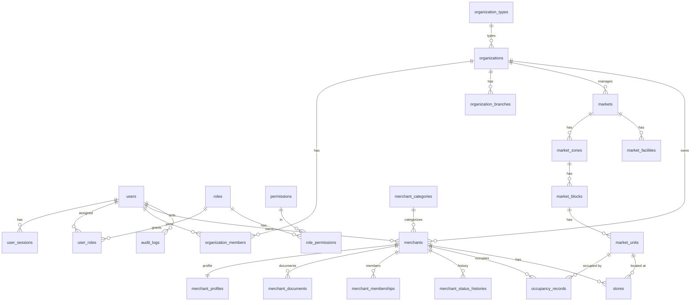

# Core Database Design — Marketara

Dokumen ini menjelaskan implementasi database core (tahap 1) dari
`Digital_Market_Ecosystem_Master_Module_Reference_v1.1.docx`.

- Database: PostgreSQL
- ORM: Drizzle ORM (`drizzle-orm/postgres-js`)
- Schema: `core`, `governance`
- Migration: `drizzle/0000_*.sql`
- Total tabel: 25

---

## 1. Cakupan Tahap 1

| Modul | Entitas utama |
| --- | --- |
| SYS-01 Identity & Access | users, roles, permissions, role_permissions, user_roles, user_sessions, authentication_logs |
| SYS-02 Organization & Membership | organization_types, organizations, organization_members, organization_branches |
| MKT-01 Market & Physical Asset | markets, market_zones, market_blocks, market_units, market_facilities, occupancy_records |
| MKT-02 Vendor & Merchant | merchant_categories, merchants, merchant_profiles, merchant_documents, merchant_memberships, merchant_status_histories, stores |
| SYS-06 Audit (minimal) | governance.audit_logs |

---

## 2. ERD Ringkas



---

## 3. Identity & Access (SYS-01)

### users

Identitas pengguna platform lintas modul.

Kolom penting: `email` (unique), `phone` (unique, nullable), `password_hash`
(Argon2id), `status` (`pending|active|suspended|inactive`), `email_verified_at`,
`phone_verified_at`, `last_login_at`, `deleted_at`.

### roles / permissions / role_permissions

- `roles.code` unik. Role sistem hasil seed: `platform_admin`, `market_admin`,
  `member`.
- `permissions.code` unik dengan format `domain:action`
  (contoh `market:write`).
- `role_permissions` adalah tabel pivot M:N role → permission.
- Permission `*` adalah wildcard untuk platform admin.

### user_roles

Role global (`organization_id = NULL`) atau scoped ke organisasi. Middleware
autentikasi saat ini membaca role global saja; role di lingkup organisasi
menggunakan `organization_members.role`.

### user_sessions

Menyimpan `token_hash` (SHA-256), bukan token asli. Sesi memiliki
`expires_at`, `revoked_at`, `last_used_at`, `ip_address`, `user_agent`.
Logout mengisi `revoked_at`.

### authentication_logs

Event: `login_success`, `login_failed`, `logout`, `session_revoked`.
Dipakai untuk audit keamanan dasar.

---

## 4. Organization & Membership (SYS-02)

### organizations

Entitas badan usaha/lembaga. Relasi:

- `type_id` → `organization_types`
- `parent_id` → `organizations` (self reference untuk hierarki)
- `created_by` → `users`

Status disimpan sebagai varchar (`active`, dst.) agar fleksibel; soft delete
via `deleted_at`.

### organization_members

Pivot user ↔ organisasi dengan:

- `role`: `owner | admin | staff | member`
- `status`: `active | invited | suspended | left`
- unique `(organization_id, user_id)`

Aturan bisnis: organisasi harus memiliki minimal satu `owner` aktif.
Endpoint mencegah demote/remove owner terakhir.

### organization_branches

Cabang organisasi, dengan penanda `is_main`. Hanya satu cabang utama yang
di-set pada satu waktu oleh endpoint.

---

## 5. Market & Physical Asset (MKT-01)

Hierarki:

```text
markets → market_zones → market_blocks → market_units
```

### markets

`code` dan `slug` unik. Terhubung opsional ke `organizations` (pengelola
pasar). Field lokasi: `address`, `city`, `province`, `postal_code`,
`latitude`, `longitude`. Status: `planned | active | inactive | maintenance |
closed`.

### market_zones / market_blocks

Kode unik per parent (`market_id + code`, `zone_id + code`). Status zona/blok:
`active | inactive | maintenance`.

### market_units

Unit/kios/lapak. Kode unik per blok. Atribut: `type`
(`kios|lapak|toko|gudang|lainnya`), `status`
(`available|occupied|reserved|maintenance|inactive`), `area_size`,
`monthly_fee`, koordinat.

### market_facilities

Fasilitas pasar: nama, tipe, lokasi, kondisi, ketersediaan.

### occupancy_records

Penempatan merchant pada unit:

- `market_unit_id` → `market_units`
- `merchant_id` → `merchants`
- `status`: `active | ended | cancelled`
- tanggal mulai/selesai, biaya bulanan, nomor perjanjian

**Constraint penting:**

```sql
CREATE UNIQUE INDEX occupancy_records_active_unit_uq
  ON core.occupancy_records (market_unit_id)
  WHERE status = 'active';
```

Satu unit hanya boleh memiliki satu occupancy aktif. Proses penempatan
menggunakan transaksi: insert occupancy + update `market_units.status =
'occupied'`. Saat occupancy diakhiri, unit kembali `available`.

Catatan: `market_assets` dan `asset_maintenance_records` dari dokumen belum
diimplementasikan pada tahap core; dapat ditambahkan pada iterasi MKT-01
berikutnya.

---

## 6. Merchant & Store (MKT-02)

### merchants

Identitas pelaku usaha. Relasi:

- `owner_user_id` → `users` (wajib)
- `organization_id` → `organizations` (opsional)
- `category_id` → `merchant_categories`

`code` dan `slug` unik. Status: `draft | pending_verification | verified |
rejected | suspended | inactive`. Field verifikasi: `verified_at`,
`verified_by`, `verification_note`.

### merchant_profiles

Relasi 1:1 dengan merchant (PK = `merchant_id`). Berisi NPWP, NIB, tahun
berdiri, jumlah karyawan, omzet tahunan, website, sosial media, deskripsi
panjang.

### merchant_documents

Metadata dokumen (file disimpan di object storage; tabel hanya menyimpan
`file_url`). Tipe dokumen fleksibel, status: `pending | verified | rejected |
expired`.

### merchant_memberships

Pivot merchant ↔ user dengan role `owner | manager | staff` dan status
keanggotaan. Owner merchant juga tercatat di sini saat merchant dibuat.

### merchant_status_histories

Riwayat transisi status merchant beserta alasan dan aktor. Ditulis saat create,
submit, dan verify.

### stores

Toko/kanal usaha merchant. Relasi:

- `merchant_id` → `merchants`
- `market_unit_id` → `market_units` (opsional, harus unit yang sedang
  di-occupy merchant tersebut)

Atribut: `type` (`physical|online|hybrid`), `status`
(`active|inactive|closed`), alamat, koordinat, `operating_hours` (JSONB),
`is_primary`. Soft delete via `deleted_at`.

---

## 7. Audit (SYS-06 minimal)

`governance.audit_logs` mencatat:

- `actor_user_id`, `action`, `entity_type`, `entity_id`
- `old_values`, `new_values` (JSONB)
- `ip_address`, `user_agent`, `created_at`

Aksi yang sudah dicatat: register, change password, create/update/archive
market, create/update merchant, verify merchant, create/end occupancy, create
store, create organization, tambah/hapus member organisasi.

Penulisan audit bersifat *best effort*: kegagalan audit tidak membatalkan
transaksi bisnis.

---

## 8. Index & Constraint Penting

| Tabel | Constraint/Index |
| --- | --- |
| users | unique email, unique phone, index status |
| user_sessions | unique token_hash, index user_id |
| organizations | unique slug, index type, index parent |
| organization_members | unique (organization_id, user_id) |
| markets | unique code, unique slug, index status/org |
| market_units | unique (block_id, code), index status |
| occupancy_records | partial unique index active per unit |
| merchants | unique code, unique slug, index owner/org/status |
| merchant_memberships | unique (merchant_id, user_id) |
| stores | unique slug, index merchant/status |
| audit_logs | index (entity_type, entity_id), actor, created_at |

Semua primary key menggunakan UUID (`gen_random_uuid()`).

---

## 9. Keputusan Desain

1. **Satu database, schema logis** — sesuai rekomendasi dokumen; belum
   memisahkan database per modul.
2. **UUID** untuk identitas agar aman untuk distribusi/API dan tidak
   mengekspos urutan data.
3. **Soft delete** pada entitas utama; histori tetap terjaga.
4. **Reference data** (`organization_types`, `merchant_categories`,
   `permissions`, `roles`) di-seed dan dapat ditambah lewat modul admin.
5. **Otorisasi berlapis** — permission global + keanggotaan organisasi +
   kepemilikan merchant.
6. **Numeric untuk uang** (`numeric(14,2)`/`(18,2)`), bukan float.
7. **JSONB hanya untuk data fleksibel** (jam operasional, snapshot audit),
   bukan untuk data yang perlu difilter/relasi ketat.
8. **Status verifikasi merchant** dipisahkan dari status operasional toko.
9. **Occupancy** menjadi sumber kebenaran keterkaitan merchant ↔ kios; store
   opsional mengacu ke unit yang sedang di-occupy.
10. **Partial unique index** untuk mencegah dua occupancy aktif pada unit yang
    sama, termasuk saat terjadi request bersamaan.

---

## 10. Rekomendasi Iterasi Berikutnya

Saat menambah schema baru, pertahankan pola:

- schema per domain: `catalog`, `commerce`, `payment`, `inventory`,
  `supply_chain`, `marketing`, `business`, `funding`, `analytics`, `platform`;
- FK ke `core.users`, `core.organizations`, `core.merchants`,
  `core.market_units`, atau `core.stores`;
- uang gunakan `numeric`;
- histori status gunakan tabel `*_status_histories`;
- dokumen simpan metadata + URL object storage;
- audit trail untuk perubahan penting;
- pertimbangkan snapshot/agregasi untuk dashboard (MKT-14/SYS-08) agar tidak
  membebani tabel transaksi.

Status modul lanjutan:

- **MKT-03** — sudah diimplementasikan di schema `catalog`; lihat
  [`catalog-database.md`](catalog-database.md).
- **MKT-04** — sudah diimplementasikan di schema `commerce`; lihat
  [`commerce-database.md`](commerce-database.md).
- **MKT-05** — sudah diimplementasikan di schema `commerce`; lihat
  [`order-database.md`](order-database.md).
- **MKT-06** — sudah diimplementasikan di schema `payment` dengan tabel
  `payment_providers`, `payment_methods`, `merchant_payment_accounts`,
  `payments`, `payment_attempts`, `payment_events`, `refunds`, `settlements`,
  `settlement_items`, dan `reconciliations`; lihat
  [`payment-database.md`](payment-database.md).
- **MKT-08** — kandidat tabel: `warehouses`, `warehouse_locations`,
  `inventory_items`, `stock_balances`, `stock_movements`, `stock_counts`,
  `inventory_batches`.
