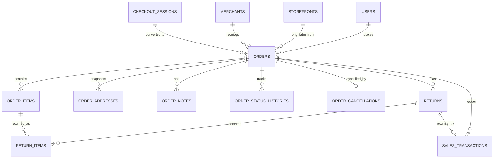

# Order Database - MKT-05 Order & Transaction

Dokumen ini menjelaskan schema `commerce` untuk modul **MKT-05 Order &
Transaction Management**. Modul ini mengubah sesi checkout menjadi pesanan,
mengelola item, status, alamat, catatan, pembatalan, retur, dan ledger
transaksi penjualan.

Pembayaran, refund, settlement, pengiriman, dan fulfillment **belum** masuk
modul ini. Entitas tersebut akan ditambahkan pada MKT-06/MKT-09 dan
mereferensikan `commerce.orders`.

- Schema PostgreSQL: `commerce`
- Tabel baru: **9**
- Migration: `drizzle/0003_nappy_ego.sql`
- Kode schema: `src/db/schema/commerce.ts`
- Kode API: `src/routes/commerce/orders.ts`, `src/routes/commerce/returns.ts`

---

## 1. Keputusan Desain

1. **Checkout adalah batas konversi.**
   - Order hanya dibuat dari `commerce.checkout_sessions` berstatus
     `draft`, `pending`, atau `ready`.
   - Setelah konversi, checkout menjadi `completed` dan cart menjadi
     `converted`.
   - Konversi bersifat idempoten: request ulang mengembalikan order yang sama.
2. **Satu checkout dipecah per merchant.**
   - Satu cart/checkout dapat berisi produk dari beberapa merchant.
   - Order dibuat satu per merchant agar setiap merchant memiliki status,
     pembatalan, dan retur sendiri.
   - Unique index `(checkout_session_id, merchant_id)` mencegah order ganda.
3. **Snapshot item dan alamat disimpan.**
   - `order_items.item_snapshot` menyimpan snapshot checkout.
   - `order_addresses` menyimpan alamat pengiriman saat order dibuat.
   - Perubahan produk/alamat setelah order tidak mengubah histori order.
4. **Harga dihitung ulang dari snapshot checkout.**
   - `unit_price` dan `line_total` dihitung dari `items_snapshot`, bukan dari
     harga produk saat ini.
   - Nilai uang memakai `numeric(16,2)` dan dikembalikan sebagai string.
5. **Status order dikelola eksplisit.**
   - Alur normal: `pending` -> `confirmed` -> `processing` -> `completed`.
   - `cancelled` hanya melalui endpoint pembatalan agar alasan tercatat.
   - `returned` otomatis saat seluruh item pesanan selesai diretur.
6. **Retur memiliki siklus sendiri.**
   - Status: `requested`, `approved`, `rejected`, `received`, `completed`,
     `cancelled`.
   - Retur hanya dapat diajukan untuk order `completed`.
   - Jumlah retur tidak boleh melebihi quantity item yang belum diretur.
7. **Ledger penjualan bukan pembayaran.**
   - `sales_transactions` mencatat `sale`, `cancellation`, dan `return`.
   - Nilai pembatalan/retur disimpan negatif.
   - Refund dan settlement tetap menjadi tanggung jawab MKT-06.
8. **Akses berbasis customer dan merchant.**
   - Customer hanya melihat order/retur miliknya.
   - Merchant melihat order/retur merchant yang boleh diakses.
   - Platform admin melihat semua.

---

## 2. ERD Ringkas



---

## 3. Tabel

### 3.1 `orders`

Header pesanan per merchant.

| Kolom | Tipe | Keterangan |
| --- | --- | --- |
| `id` | uuid PK | |
| `order_number` | varchar(32) | Unik, format `ORD-YYYYMMDD-XXXXXX` |
| `checkout_session_id` | uuid FK -> `checkout_sessions` | `ON DELETE RESTRICT` |
| `merchant_id` | uuid FK -> `core.merchants` | `ON DELETE RESTRICT` |
| `storefront_id` | uuid FK -> `storefronts` | Null jika item berasal dari beberapa storefront |
| `sales_channel_id` | uuid FK -> `sales_channels` | Kanal asal storefront |
| `user_id` | uuid FK -> `core.users` | Customer |
| `status` | enum `order_status` | Default `pending` |
| `currency` | varchar(3) | Default `IDR` |
| `item_count` | integer | Total quantity |
| `subtotal`, `discount_total`, `shipping_total`, `grand_total` | numeric(16,2) | Snapshot total |
| `contact_name`, `contact_phone`, `contact_email` | varchar | Kontak checkout |
| `placed_at` | timestamptz | Waktu order dibuat |
| `confirmed_at`, `processing_at`, `completed_at`, `cancelled_at`, `returned_at` | timestamptz | Jejak status |
| `created_at`, `updated_at` | timestamptz | |

Index: nomor order unik, pasangan checkout+merchant unik, customer, merchant,
storefront, status, dan waktu order.

### 3.2 `order_items`

Snapshot item pesanan.

| Kolom | Tipe | Keterangan |
| --- | --- | --- |
| `id` | uuid PK | |
| `order_id` | uuid FK -> `orders` | `ON DELETE CASCADE` |
| `product_id`, `sku_id`, `storefront_product_id`, `storefront_id` | uuid FK | Nullable, `SET NULL` |
| `product_name`, `product_slug`, `sku_code` | varchar | Snapshot nama/kode |
| `quantity` | integer | |
| `unit_price`, `line_total` | numeric(16,2) | |
| `currency` | varchar(3) | |
| `item_snapshot` | jsonb | Snapshot lengkap dari checkout |
| `created_at`, `updated_at` | timestamptz | |

### 3.3 `order_addresses`

Snapshot alamat pengiriman. Tabel mendukung tipe `shipping` dan `billing`,
tetapi konversi saat ini membuat satu alamat `shipping`.

| Kolom | Tipe | Keterangan |
| --- | --- | --- |
| `id` | uuid PK | |
| `order_id` | uuid FK -> `orders` | `ON DELETE CASCADE` |
| `type` | enum `order_address_type` | Default `shipping` |
| `recipient_name`, `phone` | varchar | |
| `address_line1`, `address_line2` | text | |
| `city`, `province`, `postal_code`, `country` | varchar | |
| `latitude`, `longitude` | numeric(10,7) | |
| `created_at` | timestamptz | |

Unique index `(order_id, type)` mencegah alamat ganda dengan tipe sama.

### 3.4 `order_status_histories`

Riwayat perubahan status order, termasuk status awal `pending`.

| Kolom | Tipe | Keterangan |
| --- | --- | --- |
| `id` | uuid PK | |
| `order_id` | uuid FK -> `orders` | `ON DELETE CASCADE` |
| `from_status` | enum `order_status` | Null untuk status awal |
| `to_status` | enum `order_status` | |
| `note` | text | Alasan/catatan |
| `changed_by` | uuid FK -> `core.users` | Nullable |
| `created_at` | timestamptz | |

### 3.5 `order_notes`

Catatan internal merchant atau catatan untuk pelanggan.

| Kolom | Tipe | Keterangan |
| --- | --- | --- |
| `id` | uuid PK | |
| `order_id` | uuid FK -> `orders` | `ON DELETE CASCADE` |
| `author_user_id` | uuid FK -> `core.users` | Nullable |
| `visibility` | enum `order_note_visibility` | `internal` / `customer` |
| `body` | text | |
| `created_at` | timestamptz | |

Catatan checkout (`checkout_sessions.notes`) disalin sebagai catatan
`customer` saat order dibuat.

### 3.6 `order_cancellations`

Satu pembatalan per order.

| Kolom | Tipe | Keterangan |
| --- | --- | --- |
| `id` | uuid PK | |
| `order_id` | uuid FK -> `orders` | Unique, `ON DELETE CASCADE` |
| `reason` | text | Wajib |
| `notes` | text | Opsional |
| `cancelled_by` | uuid FK -> `core.users` | Nullable |
| `created_at` | timestamptz | |

### 3.7 `returns`

Header pengajuan retur.

| Kolom | Tipe | Keterangan |
| --- | --- | --- |
| `id` | uuid PK | |
| `return_number` | varchar(32) | Unik, format `RET-YYYYMMDD-XXXXXX` |
| `order_id` | uuid FK -> `orders` | `ON DELETE CASCADE` |
| `merchant_id` | uuid FK -> `core.merchants` | `ON DELETE RESTRICT` |
| `user_id` | uuid FK -> `core.users` | Customer |
| `status` | enum `return_status` | Default `requested` |
| `reason` | text | Alasan pengajuan |
| `resolution_note` | text | Catatan keputusan merchant |
| `requested_by`, `reviewed_by` | uuid FK -> `core.users` | Nullable |
| `requested_at`, `approved_at`, `rejected_at`, `received_at`, `completed_at`, `cancelled_at` | timestamptz | Jejak status |
| `created_at`, `updated_at` | timestamptz | |

### 3.8 `return_items`

Item yang diretur. Satu baris per order item per pengajuan retur.

| Kolom | Tipe | Keterangan |
| --- | --- | --- |
| `id` | uuid PK | |
| `return_id` | uuid FK -> `returns` | `ON DELETE CASCADE` |
| `order_item_id` | uuid FK -> `order_items` | `ON DELETE CASCADE` |
| `quantity` | integer | |
| `unit_price`, `line_total` | numeric(16,2) | Snapshot harga order |
| `condition` | enum `return_item_condition` | `unopened`, `opened`, `damaged`, `defective`, `other` |
| `reason` | text | Opsional |
| `created_at` | timestamptz | |

Unique index `(return_id, order_item_id)` mencegah duplikasi item dalam satu
pengajuan.

### 3.9 `sales_transactions`

Ledger penjualan sederhana. Bukan tabel pembayaran/refund.

| Kolom | Tipe | Keterangan |
| --- | --- | --- |
| `id` | uuid PK | |
| `transaction_number` | varchar(32) | Unik, format `TRX-YYYYMMDD-XXXXXX` |
| `order_id` | uuid FK -> `orders` | `ON DELETE CASCADE` |
| `return_id` | uuid FK -> `returns` | Nullable, unik per retur |
| `merchant_id` | uuid FK -> `core.merchants` | `ON DELETE RESTRICT` |
| `type` | enum `sales_transaction_type` | `sale`, `cancellation`, `return` |
| `amount` | numeric(16,2) | Negatif untuk koreksi |
| `currency` | varchar(3) | |
| `description` | text | |
| `occurred_at` | timestamptz | |
| `created_by` | uuid FK -> `core.users` | Nullable |
| `created_at` | timestamptz | |

Unique index `return_id` mencegah transaksi retur ganda. Nilai transaksi
`return` dihitung dari total item retur yang selesai.

---

## 4. Enum

| Enum | Nilai |
| --- | --- |
| `order_status` | `pending`, `confirmed`, `processing`, `completed`, `cancelled`, `returned` |
| `order_address_type` | `shipping`, `billing` |
| `order_note_visibility` | `internal`, `customer` |
| `return_status` | `requested`, `approved`, `rejected`, `received`, `completed`, `cancelled` |
| `return_item_condition` | `unopened`, `opened`, `damaged`, `defective`, `other` |
| `sales_transaction_type` | `sale`, `cancellation`, `return` |

---

## 5. Otorisasi & Scoping

Modul ini memakai permission commerce yang sudah ada, tanpa permission baru:

| Aksi | Permission |
| --- | --- |
| Lihat order, retur, transaksi | `commerce:read` |
| Konversi checkout, ubah status, batalkan, catatan, retur | `commerce:write` |

Scoping:

- **Platform admin** (`*`) melihat semua order/retur/transaksi.
- **Customer** melihat order/retur dengan `user_id` miliknya.
- **Merchant** melihat order/retur merchant yang dapat diakses berdasarkan
  ownership, organization, atau membership.
- Merchant tidak dapat melihat order merchant lain.

Endpoint status order hanya untuk merchant/platform admin. Customer dapat
membatalkan ordernya melalui endpoint pembatalan. Customer dapat membatalkan
pengajuan retur yang masih `requested`.

---

## 6. API

Base URL: `/api/v1/commerce`

### 6.1 Order

| Method | Path | Permission | Keterangan |
| --- | --- | --- | --- |
| POST | `/orders/from-checkout/:checkoutId` | `commerce:write` | Konversi checkout menjadi order per merchant |
| GET | `/orders` | `commerce:read` | Daftar order dengan filter status, merchant, customer, tanggal, pencarian |
| GET | `/orders/:orderId` | `commerce:read` | Detail order + item, alamat, status history, catatan, retur, transaksi |
| PATCH | `/orders/:orderId/status` | `commerce:write` | Ubah status normal (`confirmed`, `processing`, `completed`) |
| POST | `/orders/:orderId/cancel` | `commerce:write` | Batalkan order + catat alasan dan ledger negatif |
| POST | `/orders/:orderId/notes` | `commerce:write` | Tambah catatan internal/customer |

Contoh konversi:

```bash
curl -X POST http://localhost:3000/api/v1/commerce/orders/from-checkout/<CHECKOUT_ID> \
  -H "Authorization: Bearer <TOKEN>"
```

Respons sukses:

```json
{
  "success": true,
  "data": {
    "checkoutId": "...",
    "created": true,
    "orders": [
      {
        "orderNumber": "ORD-20261122-ABC123",
        "status": "pending",
        "grandTotal": "50000.00",
        "items": [],
        "addresses": [],
        "statusHistory": [],
        "transactions": []
      }
    ]
  }
}
```

Jika checkout sudah pernah dikonversi, respons `200` dengan `created: false`
dan order yang sama.

### 6.2 Retur

| Method | Path | Permission | Keterangan |
| --- | --- | --- | --- |
| GET | `/returns` | `commerce:read` | Daftar retur dengan filter status, order, pencarian, tanggal |
| GET | `/returns/:returnId` | `commerce:read` | Detail retur + item |
| POST | `/orders/:orderId/returns` | `commerce:write` | Ajukan retur untuk order `completed` |
| PATCH | `/returns/:returnId/status` | `commerce:write` | Ubah status retur |

Transisi retur:

```text
requested -> approved -> received -> completed
requested -> rejected
requested -> cancelled
approved  -> cancelled
```

Saat retur `completed`, ledger mencatat transaksi `return` negatif. Jika seluruh
quantity item order sudah diretur, status order berubah menjadi `returned`.

### 6.3 Transaksi

| Method | Path | Permission | Keterangan |
| --- | --- | --- | --- |
| GET | `/transactions` | `commerce:read` | Ledger penjualan dengan filter tipe, order, merchant, pencarian, tanggal |

Tipe transaksi: `sale` (positif), `cancellation` (negatif), `return`
(negatif).

---

## 7. Integritas & Batasan

1. Order hanya dibuat dari checkout milik user yang login.
2. Merchant harus masih `verified` saat konversi.
3. Checkout yang kedaluwarsa ditolak dan ditandai `expired`.
4. Konversi berjalan dalam transaksi database dan mengunci baris checkout
   (`SELECT ... FOR UPDATE`).
5. Order ganda dicegah oleh unique index checkout+merchant.
6. Pembatalan hanya untuk order `pending`, `confirmed`, atau `processing`.
7. Status normal tidak dapat melompat atau mundur.
8. Retur hanya untuk order `completed`.
9. Quantity retur divalidasi terhadap quantity order dikurangi retur aktif.
10. Ledger retur hanya dibuat sekali per retur.
11. `sales_transactions` tidak memproses uang; refund/settlement di MKT-06.

---

## 8. UI Admin Pesanan

Dashboard admin memiliki menu **Pesanan** setelah Commerce, dengan:

- daftar order: nomor, pelanggan, pedagang, status, total, dan aksi;
- filter status dan pencarian nomor/pedagang/pelanggan;
- aksi konfirmasi, proses, selesaikan, dan batalkan;
- modal detail order: item, alamat, riwayat status, catatan, retur, transaksi;
- panel retur dengan detail dan aksi setujui/tolak/terima/selesaikan;
- panel ledger transaksi penjualan.

Menu dan aksi mengikuti permission `commerce:read` / `commerce:write`.

---

## 9. Verifikasi

Smoke test end-to-end yang dijalankan:

- login admin;
- membuat merchant, verifikasi, produk, SKU, storefront published;
- menambah produk storefront, alamat, cart, dan checkout;
- konversi checkout menjadi order;
- konversi ulang (idempoten);
- daftar dan detail order;
- catatan internal;
- transisi `pending -> confirmed -> processing -> completed`;
- pengajuan retur, validasi quantity berlebih, approve, receive, complete;
- ledger sale + return dengan nilai bersih benar;
- order kedua, pembatalan, ledger cancellation negatif, dan penolakan
  pembatalan ulang;
- akses customer: hanya order sendiri yang terlihat, catatan internal tidak
  dikembalikan, customer tidak dapat mengubah status order, customer hanya
  dapat membatalkan retur berstatus `requested`;
- UI admin headless: navigasi Pesanan, tabel order/retur/transaksi, detail
  order, detail retur, dan modal pembatalan tampil tanpa error runtime.

Hasil: **53/53 pemeriksaan order**, **17/17 pemeriksaan akses customer**, dan
**14/14 pemeriksaan UI admin** lulus. Typecheck TypeScript dan
`node --check public/assets/admin.js` juga lulus.
